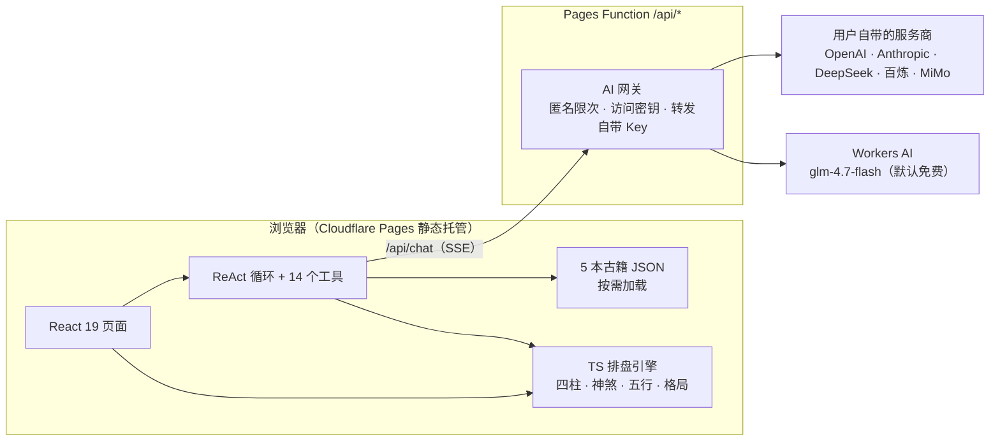

# FOR-BAZI · 玄冥

> 八字排盘与解读。四柱、十神、五行、格局、大运流年在浏览器里按规则算出；AI 只负责解读，引用干支和古籍前必须调用工具核对。

<p align="center">
  
  
  
  
  
  
</p>

<p align="center">
  <a href="#快速开始">快速开始</a> · <a href="docs/ARCHITECTURE.md">架构</a> · <a href="docs/DEPLOYMENT.md">部署</a> · <a href="docs/API.md">Python API</a>
</p>

---

## 做了什么

排盘是确定性计算，不应该交给大模型。这个项目把两件事分开：

- **算**：四柱、藏干、十神、纳音、神煞、五行力量、格局、大运流年，全部由引擎按规则算出。引擎有 Python 和 TypeScript 两份实现，用 18 个边界命例（立春交节、晚子时跨日、闰年、大运顺逆等）逐字段对拍，保证两边结果一致。
- **说**：大模型只在算好的命盘上解读，并被约束在 ReAct 循环里。它要引用某年干支、所在大运、古籍原文，必须先调用对应工具去取；收尾时 `fact_check_ganzhi` 会反查干支有没有说错。

网页版不需要任何后端：排盘、14 个工具、古籍检索都在浏览器里执行，只有模型调用经过一个同源的 Cloudflare Pages Function 网关。出生信息不离开用户的设备。

## 功能

| 页面 | 内容 |
|---|---|
| 排盘 | 公历或农历（含闰月）输入；可按出生地经度做真太阳时校正，1986–1991 年夏令时自动扣除；填完即时预览四柱；排过的命盘保存在本机，可切换、删除 |
| 命盘 | 四柱表（十神、藏干、纳音、地势、旬空、神煞）；格局与日主强弱；原局干支关系弧线图；五行生克图；大运轨道 |
| 大运 | 十步大运的十神与纳音、与原局的合冲刑害；每步运里十个流年，带冲的年份有标记 |
| 流年 | 1900–2100 任选一年，看它与原局四柱、与所在大运的关系；年份写在地址栏，可收藏分享 |
| 五行 | 力量占比、帮身与耗身、每一行由哪些字构成、《穷通宝鉴》对应月份的调候原文 |
| 十神 | 五类十神的分布、落宫表、命中各十神的含义 |
| 神煞 | 19 种常用神煞的落柱与释义 |
| 解读 | 完整 / 事业财运 / 感情婚姻 / 明年四个主题，结果保存在本机，可复制、存文件、打印 |
| 问事 | 就具体问题追问；对话绑定命盘，换了命盘会提示开新对话 |
| 设置 | 免费额度与访问密钥、自带 AI 服务商、昼夜主题、清除本地数据 |

**复制给 AI**：命盘页、解读页、问事页都有这个按钮，一点就把整份命盘整理成 Markdown 放进剪贴板，开头写明「以此为准，不要重新排盘」。可以粘给 ChatGPT、Claude、DeepSeek、豆包、Kimi 等任何 AI。「选项」里可以改成只要数据或 JSON，隐去出生时间，附上古籍原文，或者换成自己的问题。

**界面**：细线分栏、不用卡片；干支用重磅宋体，五行色只落在字上。昼夜两套主题，默认跟随系统。手机上有底部导航，可以添加到主屏幕。

## 架构



网关只做三件事：匿名访问按 IP 每日限次（默认 5 次，计数存 KV）；持访问密钥不限次；用户在设置里填了自己的 Key 时，原样转发给对方服务商（只允许白名单里的域名）。它不碰任何命理逻辑。

Python 部分（`engine/`、`tools/`、`agent/`、`backend/`）仍然完整保留：它是 TS 引擎的对拍基准，也给桌面版、MCP 服务器和 Streamlit 旧版用。

## 项目结构

```
FOR-BAZI/
├── frontend/
│   ├── src/
│   │   ├── engine/            # TS 排盘引擎（bazi · shensha · wuxing · geju · xingchong · classics · tools · prompt）
│   │   ├── lib/               # chart-view（展示模型）· chart-text（复制文本）· solar-time · relations · react-agent · api
│   │   ├── pages/             # 10 个页面，按路由懒加载
│   │   ├── components/        # bazi（四柱表、关系图、生克图、大运轨道……）· chat · layout · ui
│   │   └── stores/            # Zustand：命盘与历史 · 对话 · 解读存档 · 设置
│   ├── functions/api/         # Pages Function：AI 网关
│   ├── scripts/               # 字体子集生成
│   └── wrangler.toml
├── engine/                    # Python 引擎（对拍基准）
├── tools/                     # Python 工具：五行精算 · 格局 · 14 个 Agent 工具
├── agent/ · prompts/          # Python ReAct Agent 与提示词
├── backend/                   # FastAPI（桌面版与本地开发用）
├── data/classical_texts/      # 穷通宝鉴 · 滴天髓 · 子平真诠 · 三命通会 · 渊海子平
├── scripts/gen_golden_fixtures.py   # 从 Python 引擎导出对拍基准
├── tests/                     # pytest；fixtures/golden_charts.json 为对拍基准
├── mcp_server/                # MCP 工具服务器
└── docs/
```

## 快速开始

只跑网页版，有 Node.js 18+ 就够：

```bash
git clone https://github.com/gaaiyun/FOR-BAZI.git
cd FOR-BAZI/frontend
npm install
npm run dev
```

打开 http://localhost:5173 即可排盘、看全部图表、复制命盘。站内 AI 解读需要网关，本地有两种办法：

- 用 `npx wrangler pages dev dist`（先 `npm run build`）在本地同时跑静态页和网关；
- 或者在「设置」里选一个服务商、填自己的 Key。

部署到 Cloudflare Pages 的完整步骤（KV、访问密钥、模型选择）见 [docs/DEPLOYMENT.md](docs/DEPLOYMENT.md#cloudflare-pages网页版推荐)。

> **模型必须支持 function calling。** ReAct 循环每轮都带工具 schema，不支持工具调用的模型会静默忽略它们，查流年、查古籍这些取证步骤就不会执行。Workers AI 免费额度内可用：`@cf/zai-org/glm-4.7-flash`（默认）、`@cf/qwen/qwen3-30b-a3b-fp8`、`@cf/meta/llama-3.3-70b-instruct-fp8-fast`。

### Python 后端（可选）

桌面版、MCP 服务器和 Python 测试需要它：

```bash
pip install -r requirements.txt
python -m uvicorn backend.main:app --reload --port 8000
```

AI 凭据通过 `.env` 配置（`BAZI_` 前缀），变量说明见 [docs/DEPLOYMENT.md](docs/DEPLOYMENT.md#环境变量)。

## 测试

```bash
# 前端：引擎对拍、复制文本、真太阳时、农历、干支关系、神煞释义覆盖
cd frontend && npm test

# Python：引擎、工具、Agent、API
python -m pytest -q
```

改了 Python 引擎的输出，要重新导出对拍基准，再跑前端测试确认 TS 版跟上：

```bash
python scripts/gen_golden_fixtures.py tests/fixtures/golden_charts.json
cd frontend && npm test
```

## 技术栈

| 层 | 技术 |
|---|---|
| 前端 | React 19 · TypeScript · Vite 8 · Tailwind CSS 4 · Zustand 5 · lunar-typescript · react-markdown |
| 网关 | Cloudflare Pages Functions · Workers AI · KV |
| Python | FastAPI · lunar-python · OpenAI / Anthropic SDK · ChromaDB |
| 字体 | 思源宋体（fontsource 分片按需加载）+ 干支大字 29 字子集 · Geist |
| 测试 | vitest 380 · pytest 506 |

## 许可证

MIT License。命理属传统文化范畴，程序按既定规则运行，不代表结论具有科学预测效力。
