# FOR-BAZI 架构文档

> 系统架构、模块职责、数据流。第 3–6、9 节描述的是 Python 后端（桌面版与 MCP 使用）。

---

## 1. 总体架构

网页版的计算全部在浏览器里完成：排盘引擎、14 个 Agent 工具、5 本古籍的检索都打包进前端，
只有模型补全经过一个同源的 Pages Function 网关。Python 部分保留为对拍基准，
并服务桌面版、MCP 服务器和 Streamlit 旧版。

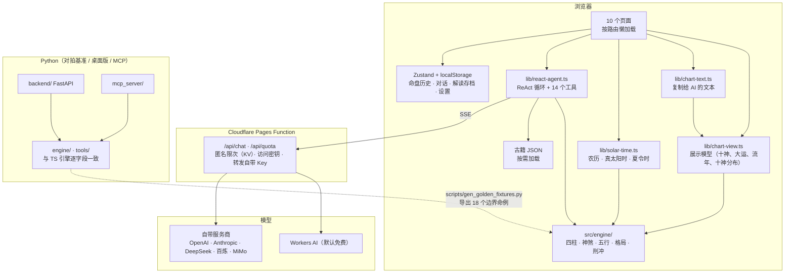

### 引擎为什么有两份

排盘移到浏览器之后，站点可以纯静态部署，用户的出生信息也不再离开设备。代价是要维护两份实现。
约束办法是对拍：`scripts/gen_golden_fixtures.py` 从 Python 引擎导出 18 个边界命例
（立春交节、晚子时跨日、除夕、闰年、大运顺逆、从格边界等）的全部字段，
`frontend/src/engine/parity.test.ts` 要求 TS 引擎逐字段相等，包括同柱多个神煞的先后顺序。
改任何一边的规则，都要两边一起改，再重新导出基准。

---

## 2. 前端架构

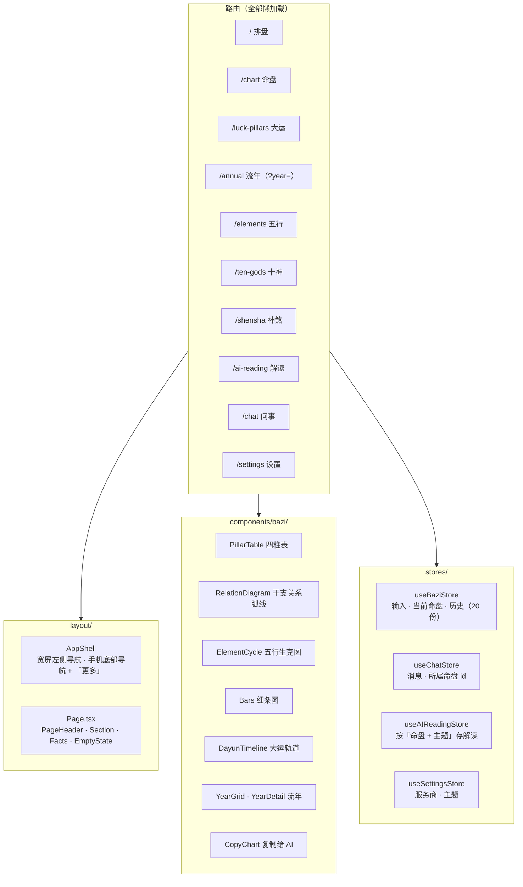

### 数据流

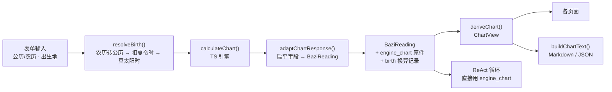

- `BaziReading` 同时带着嵌套结构（页面用）和引擎原件 `engine_chart`（工具用），免去来回转换。
- 所有派生量（藏干十神、大运十神、虚岁、十神加权分布、原局关系）只在 `deriveChart()` 里算一次，
  页面和复制文本用的是同一份，口径不会分叉。
- 外来干支（某步大运、某个流年）与原局的合冲刑害由 `lib/relations.ts` 计算，只报事实，不下吉凶。

### 视觉约定

- 不用卡片，靠细线和留白分区；墨色加一种朱砂强调色，昼夜两套主题由 `lib/theme.ts` 切换，
  `index.html` 里的内联脚本在首帧前定好主题，避免闪烁。
- 五行色是 CSS 变量（`--wx-wood` 等），昼夜各一套明度。`getCharColor()` 返回的是 `var(...)`，
  要半透明请用 `tint()`（`color-mix`），不能往后拼十六进制透明度。
- 字体：思源宋体 400/600 用 fontsource 的分片版，浏览器只下载页面上出现的字所在的分片；
  干支大字另有一个 29 字的 900 字重子集（`frontend/scripts/subset_glyph_font.py` 生成，约 5 KB）。

---

## 3. 后端架构

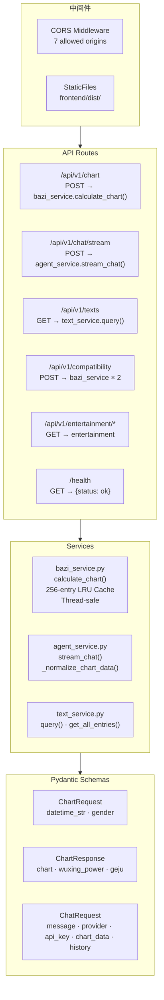

---

## 4. AI Agent 架构

### ReAct 推理循环

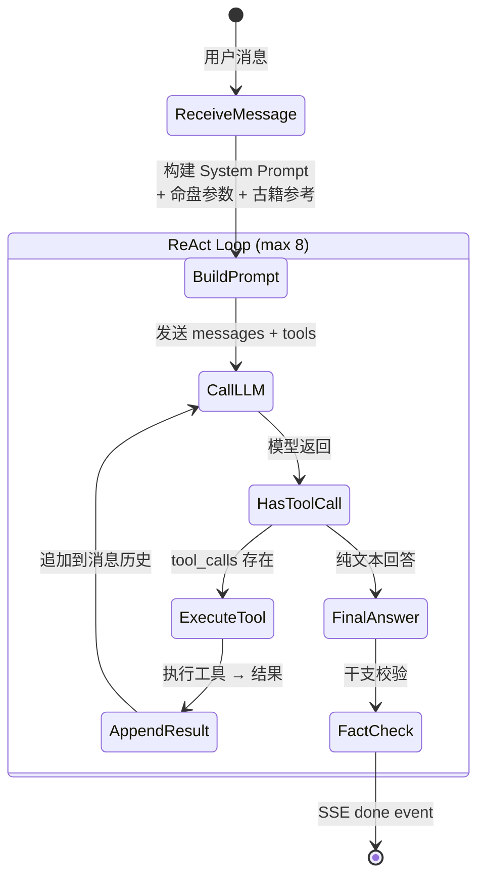

### API 适配层

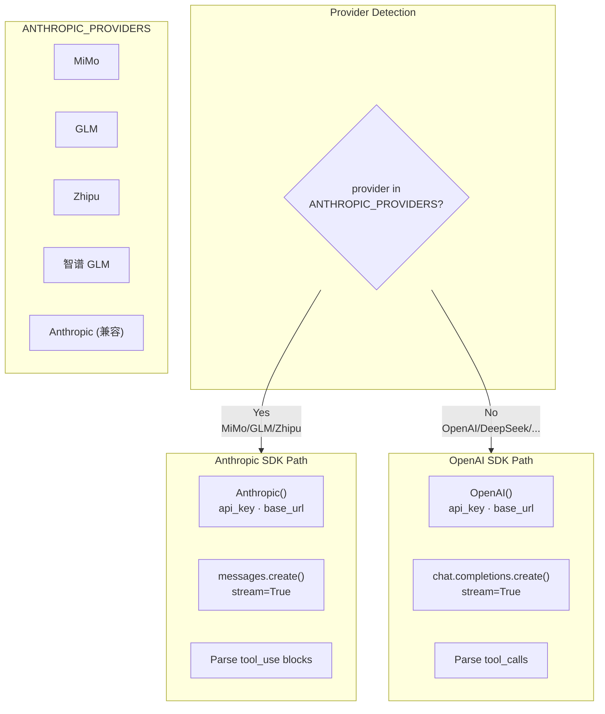

### 14 个工具注册表

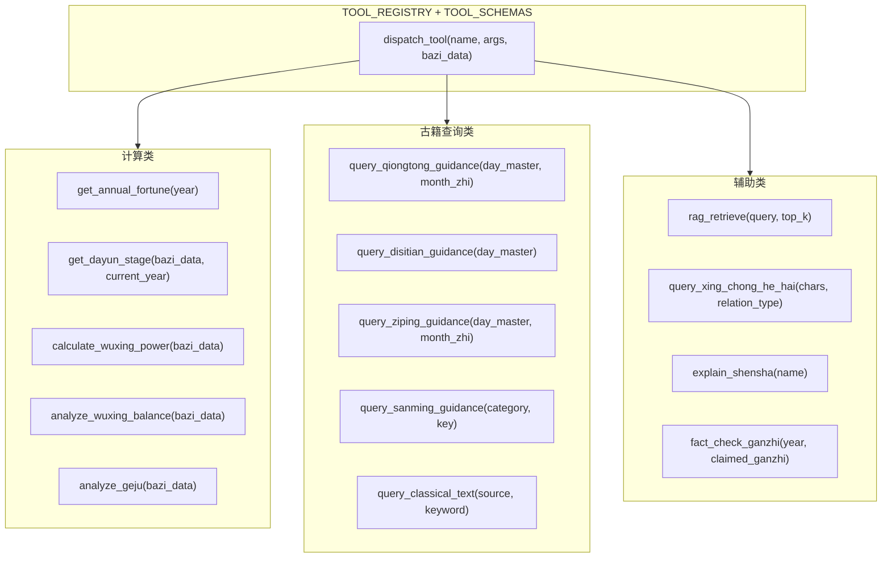

---

## 5. SSE 流式通信

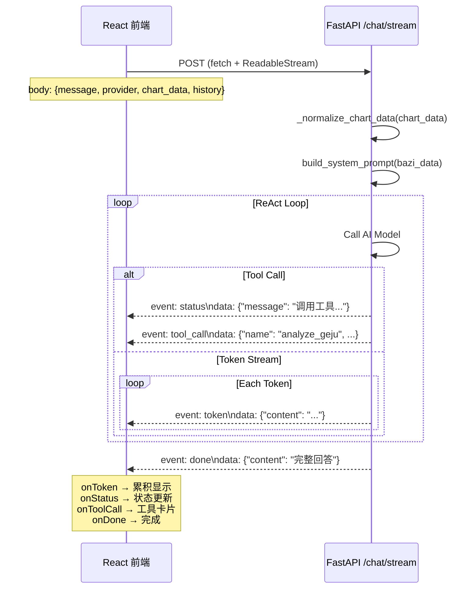

---

## 6. 数据模型

### 命盘数据流转

```mermaid
graph LR
    subgraph Input["用户输入 BaziInput"]
        I_DT["birth_date: '1985-06-15'"]
        I_TM["birth_time: '09:20'"]
        I_GD["gender: 'male'"]
    end

    subgraph Engine["引擎输出 (Flat)"]
        E_P["pillars: str[4]"]
        E_TG["tg_gan: str[4]"]
        E_TZ["tg_zhi: str[4]"]
        E_N["nayin: str[4]"]
        E_DM["day_master: str"]
        E_GD["gender: '乾造 (Male)'"]
        E_MG["minggong: str"]
        E_TY["taiyuan: str"]
        E_SG["shengong: str"]
        E_TX["taixi: str"]
        E_DS["dishi: str[4]"]
        E_XK["xunkong: str[4]"]
        E_SS["shensha: str[]"]
        E_SD["shensha_detail: dict"]
        E_WX["wuxing: dict"]
        E_XC["xingchong: dict"]
        E_DY["dayun: list"]
    end

    subgraph Frontend["前端 BaziReading"]
        F_C["chart: {<br/>  year/month/day/hour_pillar: Pillar<br/>  day_master: str<br/>}"]
        F_EB["element_balance: dict"]
        F_TG["ten_gods: TenGod[]"]
        F_DY["dayun: DayunEntry[]"]
        F_AP["annual_pillars: AnnualPillar[]"]
        F_PA["pillar_annotations: dict"]
        F_WP["wuxing_power: WuxingPower"]
        F_GJ["geju: Geju"]
        F_MG["ming_gong: str"]
        F_TY["tai_yuan: str"]
        F_GD["gender: str"]
    end

    Input -->|"calculateBazi()"| Engine
    Engine -->|"adaptChartResponse()"| Frontend
```

### Pydantic Schemas

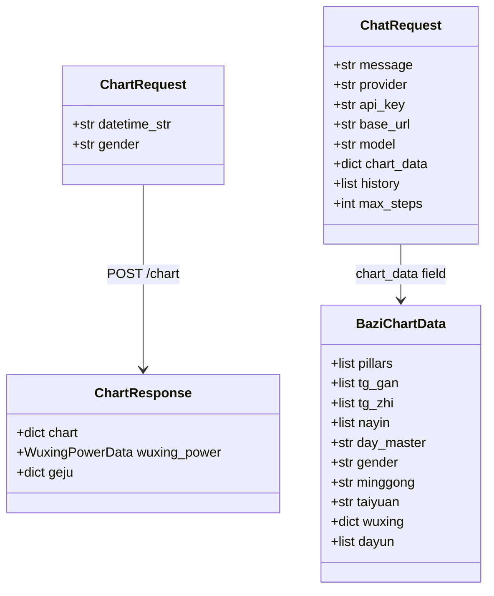

---

## 7. 测试架构

| 套件 | 数量 | 覆盖 |
|---|---|---|
| `frontend` vitest | 380 | TS 与 Python 引擎对拍（18 命例 × 全字段）、复制文本、真太阳时与夏令时、农历与闰月、外来干支关系、神煞释义覆盖 |
| `tests/` pytest | 506 | 引擎、五行与格局、14 个工具、第二批神煞规则、Agent 服务、API、古籍数据 |

对拍基准 `tests/fixtures/golden_charts.json` 由 Python 引擎导出。改了 Python 引擎的输出之后：

```bash
python scripts/gen_golden_fixtures.py tests/fixtures/golden_charts.json
cd frontend && npm test
```

---

## 8. 部署模式

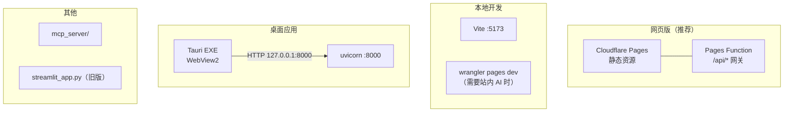

网页版部署步骤见 [DEPLOYMENT.md](DEPLOYMENT.md#cloudflare-pages网页版推荐)。

---

## 9. 配置系统

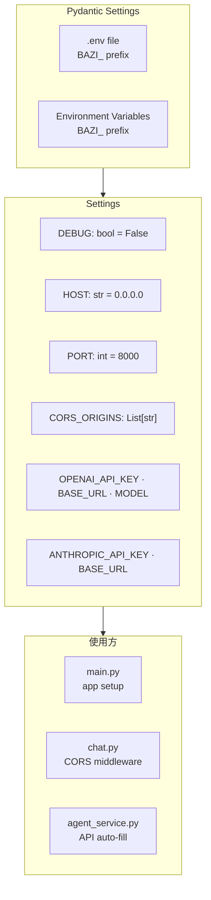
